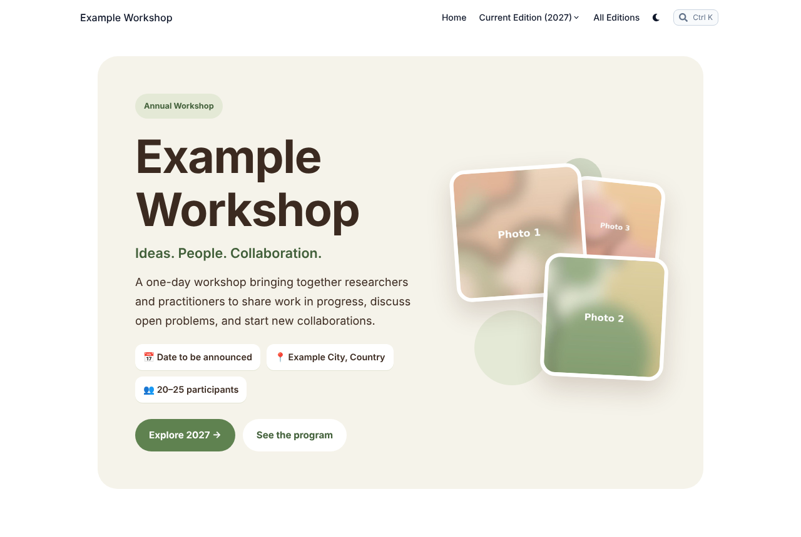
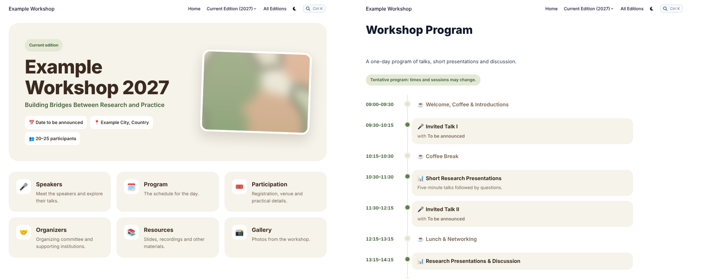

# Perennial

Perennial is a website template for events that come back every year, such as **workshops, seminars and recurring events**, built with [Hugo](https://gohugo.io) and the [Blowfish](https://blowfish.page) theme.

Everything you change lives in a few YAML files: no HTML needed. Push to GitHub and the site publishes itself on GitHub Pages.

**[Live demo →](https://ehsanyousefzadehasl.github.io/perennial-hugo/)**



## Features

- **Warm, friendly design** with a **colour palette you choose** in one line (`sage`, `terracotta` or `berry`, or your own colour)
- **Homepage from YAML:** name, tagline, description, a photo collage and any number of sections (text and/or cards)
- **Editions:** one page per year, plus an archive of all current, upcoming and past editions
- **Page switches:** turn Speakers, Program, Participation, Organizers, Resources and Gallery on or off in one list
- **Program timeline**, speaker and organizer cards, and info cards for registration, venue and contact
- **Photo gallery:** drop photos into a folder; thumbnails are generated automatically
- **Automatic publishing:** a GitHub Actions workflow deploys to GitHub Pages on every push to `main`
- **Docker image:** a multi-stage Dockerfile (Hugo build, served by nginx) for hosting anywhere
- Dark mode, search and a responsive layout, provided by Blowfish



## Quick start (about 5 minutes)

1. Click **Use this template → Create a new repository** at the top of this page.
2. In your new repository, open **Settings → Pages** and set **Source** to **GitHub Actions**.
3. Edit the files described below. You can do this directly on GitHub.
4. Commit to `main`. After a minute or two, your site is live at
   `https://<your-username>.github.io/<your-repository>/`.
   Progress is shown in the **Actions** tab.

## What to edit

| What | File |
|---|---|
| Workshop name | `config/_default/languages.en.toml` → `title` |
| Homepage text and sections | `data/site.yaml` |
| Colours | `data/site.yaml` → `palette:` (and optional `accent:`) |
| Which pages each edition has | `data/site.yaml` → `pages:` (set `show: false` to hide one) |
| Years, locations, dates | `data/editions.yaml` |
| Speakers | `data/speakers/<year>.yaml` |
| Program | `data/program/<year>.yaml` |
| Registration, venue, travel | `data/participation/<year>.yaml` |
| Organizers and supporters | `data/organizers/<year>.yaml` |
| Slides, recordings, links | `data/resources/<year>.yaml` |
| Gallery photos | put images in `content/<year>/gallery/` |
| Edition banner (optional) | `static/images/editions/<year>.jpg` |

Each YAML file starts with comments that explain its fields.

### Homepage sections

Sections in `data/site.yaml` appear in the order you list them. Each one can have a heading, text (Markdown allowed) and cards:

```yaml
sections:
  - heading: "About"
    text: "We meet once a year to **share ideas**."
  - heading: "Topics"
    cards:
      - title: "First topic"
        text: "Short description."
```

Delete a section to remove it from the homepage.

### Colours

Pick a palette in `data/site.yaml`; it is applied to every page, including the menu and dark mode:

```yaml
palette: sage          # sage | terracotta | berry
# accent: "#2563eb"    # optional: your own main colour instead
```

### Images

Put images in `static/images/...` and refer to them **without a leading slash**:

```yaml
image: "images/speakers/2027/jane.jpg"   # works locally and on GitHub Pages
```

Speakers and organizers without an image show their initial instead.

The homepage collage shows the first three photos of the current edition's gallery (`content/<year>/gallery/`), or the edition banner if there are none yet.

## Adding next year's edition

1. In `data/editions.yaml`, add the new year, set `current` to it, and mark the previous edition `status: past`.
2. Copy `content/<last-year>/` to `content/<new-year>/` and update the titles.
3. Copy the data files, for example `data/program/<last-year>.yaml` → `data/program/<new-year>.yaml`, and edit them.

Previous editions stay online and appear under **All Editions**.

## Run locally

You need [Hugo extended](https://gohugo.io/installation/) (0.169 or newer; the GitHub workflow uses 0.169.0) and git.

```bash
git clone --recurse-submodules https://github.com/<you>/<your-repository>.git
cd <your-repository>
hugo server
```

Then open http://localhost:1313. The page reloads automatically when you save a file.

The Blowfish theme is a **git submodule**. If `themes/blowfish` is empty, run:

```bash
git submodule update --init
```

## Run with Docker

```bash
docker build -t workshop-site .
docker run --rm -p 8080:80 workshop-site
```

Then open http://localhost:8080. If you host the image on your own server, set `baseURL` in `config/_default/hugo.toml` to your domain.

## Project structure

```
config/_default/     site settings (name, menus, theme options)
content/<year>/      pages of each edition
data/                all editable content (YAML)
layouts/             templates; normally no need to edit
assets/css/          shared styles (cards, timeline, buttons)
static/images/       images
themes/blowfish/     the theme (git submodule; do not edit)
.github/workflows/   automatic publishing to GitHub Pages
Dockerfile           container image (Hugo build + nginx)
```

## Credits and license

- Built with [Hugo](https://gohugo.io) and the [Blowfish](https://github.com/nunocoracao/blowfish) theme (MIT).
- Placeholder images are original and free to reuse.
- This template is released under the [MIT License](LICENSE).
